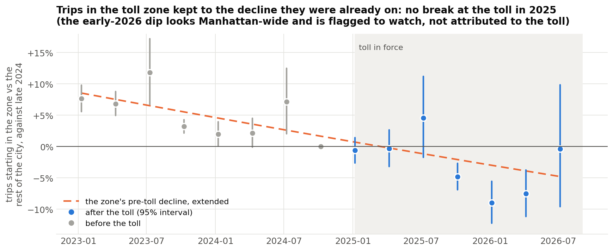
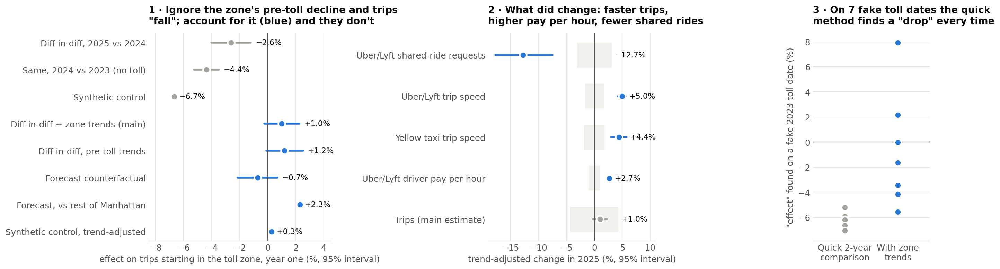

# Did NYC's Congestion Toll Cut Taxi and Uber/Lyft Trips?

[](https://github.com/janeruxi1/nyc-congestion-toll-causal-impact/actions)

[](https://janeruxi1-nyc-congestion-toll-causal-impact.streamlit.app/)

**[Decision memo](reports/decision_memo.md)** · **[Live demo](https://janeruxi1-nyc-congestion-toll-causal-impact.streamlit.app/)** · **[One-page summary](reports/PROJECT_SUMMARY.md)** · **[Full results](docs/results.md)** · **[Phase by phase](docs/PHASES.md)**

On 5 January 2025 New York began charging vehicles that enter Manhattan below 60th Street, the first
congestion toll in the US; taxi riders pay $0.75 per trip in the zone and Uber/Lyft riders $1.50. Did that
cut trips? This study uses every TLC trip record from January 2022 to August 2026 (1,288,695,819 trips kept)
and three causal methods that check each other. CI checks every number below against the recorded results.

## Key results

- **No detectable effect on trips in year one.** The best estimate is **+1.0%** (95% CI −0.3% to +2.3%), and
  every method that accounts for the zone's pre-toll decline lands between −0.7% and +2.3%.
- **The quick answer is wrong.** A 2025-vs-2024 comparison shows **−2.6%**, but the same comparison a year
  earlier, with no toll, shows **−4.4%**: the zone was already losing about 4% of its share of trips a year.
- **What did change:** trips got faster (Uber/Lyft **+5.0%**, yellow taxis **+4.4%**), Uber/Lyft driver pay
  per hour on a trip rose **+2.7%**, and shared-ride requests fell **−12.7%**, each well beyond what the same
  method finds on fake toll dates.
- **For an operator:** treat the fee as a pass-through and don't fund promotions to offset it; shared rides
  are the one targeted offer worth testing.



*Event study: trips starting in the toll zone relative to the rest of the city, by quarter, against the
fourth quarter of 2024, with 95% intervals. The dashed line extends the zone's pre-toll decline; after the
toll, trips stay close to it. Drawn from the recorded results by `scripts/make_readme_figure.py`.*

## How it works

| Step | Method | Where |
|---|---|---|
| Data audit | 168 monthly files reduced with DuckDB; cleaning audit; tolled zones derived from the fee trips paid | [01](notebooks/01_data_audit.ipynb) |
| Trends | Growth by area and service; the toll zone's share of trips against its pre-toll trend | [02](notebooks/02_trends.ipynb) |
| Difference-in-differences | Zone and week fixed effects, zone-specific trends, event study, placebo year, seven fake toll dates, other outcomes | [03](notebooks/03_difference_in_differences.ipynb) |
| Forecast counterfactual | Seasonal naive vs regression vs LightGBM, rolling-origin backtests with no-toll periods | [04](notebooks/04_forecast_counterfactual.ipynb) |
| Synthetic control | Constrained least squares over donor zones, standard and trend-adjusted, placebo-in-space p-values | [05](notebooks/05_synthetic_control.ipynb) |
| Robust inference | Wild cluster bootstrap; HonestDiD sensitivity to a bending trend, with break-down points | [07](notebooks/07_robust_inference.ipynb) |
| At scale | The same aggregation on AWS S3 + Athena, reconciled with the laptop build table by table | [`cloud/`](cloud/README.md) |



*Left: the toll's effect on trips by method, with 95% intervals; grey methods ignore the pre-toll decline.
Middle: outcomes that did change; the grey band is the typical "effect" the same method finds on fake toll
dates. Right: the quick comparison finds a drop on every fake 2023 toll date.*

## Data

[NYC TLC trip records](https://www.nyc.gov/site/tlc/about/tlc-trip-record-data.page) (yellow taxi, green
taxi, Uber/Lyft), TLC taxi zones and NOAA Central Park weather. Raw files are downloaded, reduced to daily
totals by pickup zone and deleted; only the 36 MB of aggregates is committed, so every notebook runs on a
fresh clone. See [`data/README.md`](data/README.md).

## Limits

- **Observational:** no randomized control group. On fake toll dates the main method finds "effects" of
  typically ±4%, so the claim is "no detectable effect", not "exactly zero".
- **Trips, not demand:** faster trips let the same drivers serve more rides, which could hide a small drop in
  rider demand; unfulfilled requests are not in the data.
- **Year 2 is fragile:** an early-2026 decline looks Manhattan-wide and is flagged to watch, not attributed to the toll.

<details>
<summary><b>Run it</b></summary>

```bash
pip install -r requirements.txt
pytest                                              # about 30 s
for nb in notebooks/0*.py; do python "$nb"; done    # all results from the committed aggregates (~2 min)
python scripts/build_data.py --first 2022-01 --last 2026-08   # optional: rebuild the aggregates (~30 GB)
streamlit run app/streamlit_app.py                  # the demo (6 tabs)
```

</details>

<details>
<summary><b>Repository layout</b></summary>

```
reports/decision_memo.md, PROJECT_SUMMARY.md   the recommendation and a one-page summary
reports/metrics/, reports/figures/             every number and figure, written by the notebooks
docs/results.md, docs/PHASES.md                full results; the project phase by phase
notebooks/01-07                                .py sources (run in CI) + executed .ipynb
src/congestion/                                zones, etl, athena, panel, did, inference, forecast, synth
cloud/                                         the AWS S3 + Athena build: CloudFormation, SQL, guide
data/processed/, app/, tests/                  committed aggregates, the demo, tests
```

</details>

**Related:** [Ride-hailing driver pay](https://github.com/janeruxi1/ridehail-driver-pay-optimization) took the
first look at the toll · [Product analytics in SQL](https://github.com/janeruxi1/ecommerce-sql-product-analytics) ·
[All projects](https://github.com/janeruxi1)
