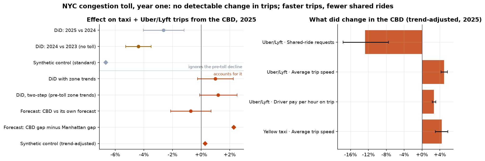
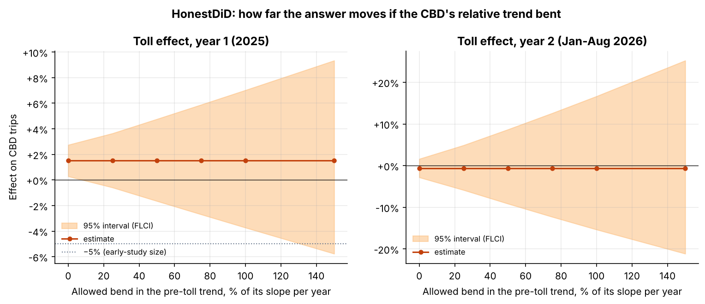

# Did NYC's Congestion Toll Cut Taxi and Uber/Lyft Trips? A Causal Study on 1.3 Billion Trips

[](https://github.com/janeruxi1/nyc-congestion-toll-causal-impact/actions)
[](https://www.python.org/)
[](https://janeruxi1-nyc-congestion-toll-causal-impact.streamlit.app/)
[](LICENSE)

On 5 January 2025 New York started charging vehicles that enter Manhattan below 60th Street,
the first congestion toll in the US. Taxi riders pay $0.75 per trip in the zone and Uber/Lyft
riders $1.50. This project asks what that did to taxi and ride-hail trips, using every trip
record the NYC Taxi & Limousine Commission (TLC) published from January 2022 to August 2026, and
three causal methods that check each other.

## TL;DR

**Question:** did the toll reduce taxi and Uber/Lyft trips starting in the toll zone (the CBD)?
**Answer:** **no detectable effect in year one.** The best estimate is **+1.0%** (95% CI −0.3% to
+2.3%), and all three methods that account for the pre-toll trend land between −0.7% and +2.3%.
**Why the quick answer is wrong:** a simple 2025-vs-2024 comparison shows **−2.6%**, but the
same comparison a year earlier, with no toll, shows **−4.4%**. The CBD was already losing share
of trips by about 4% a year before the toll.
**What did change:** CBD trips got faster (Uber/Lyft **+5.0%**, yellow taxis **+4.4%**),
Uber/Lyft driver pay per hour on a trip rose (**+2.7%**) and shared-ride requests fell
(**−12.7%**), each well beyond what the same method finds on fake toll dates.
**Price sensitivity:** the fee added **4.3%** to the price of a CBD trip; the forecast check
rules out a price elasticity much stronger than **−0.5**. Riders paid **$148.7M** in per-trip
CBD fees in 2025.
**Caveat:** observational data, and no method can rule out a small effect. Run on seven fake
toll dates in 2023, the main method finds "effects" of typically ±4.3%; the forecast's no-toll
backtests miss by up to ±1.4%. So the claim is "no detectable effect", not "exactly zero". A
decline in early 2026 (−3.6%) looks Manhattan-wide in the forecast check; it is flagged to
watch, not attributed to the toll.
**Stress tests:** a wild cluster bootstrap leaves the main interval almost unchanged
(−0.3% to +2.3%). A HonestDiD sensitivity analysis shows that a toll-driven drop of 5% or more stays
ruled out unless the CBD's relative decline sped up, in the toll year itself, by more than
131% of its pre-toll pace.



**Fastest way in:** [`reports/PROJECT_SUMMARY.md`](reports/PROJECT_SUMMARY.md) (one page, every
number traced to its notebook), then the [decision memo](reports/decision_memo.md). For how the
project was built step by step, and the design choices and objections at each step, see
[`docs/PHASES.md`](docs/PHASES.md).

## Why this question

For a ride-hail or taxi operator, the toll is a natural experiment in price and congestion at
once: riders pay more, but the streets get emptier. Whether demand dropped decides whether
platforms should offset the fee with promotions, move supply out of the zone, or do nothing.
Two published studies looked at parts of it. [Cook et al. (NBER WP 33584)](https://www.nber.org/digest/202506/impact-new-york-citys-congestion-pricing-program)
found road speeds in the zone rose 15% using Google traffic data. [Pandey, Guler & Gayah (*Findings*, 2026)](https://findingspress.org/article/155761-the-effect-of-the-new-york-city-congestion-toll-on-trips-served-by-transportation-network-companies)
found Uber/Lyft trips fell about 6% in the first 14 weeks with a 2025-vs-2024
difference-in-differences. This project adds taxis, 20 months of post-toll data, fares, waits,
driver pay and shared rides, and checks for the pre-existing decline that a single-year
comparison can pick up as an effect.

## Data

| Source | What | Size |
|---|---|---|
| [TLC trip records](https://www.nyc.gov/site/tlc/about/tlc-trip-record-data.page) | Yellow taxi, green taxi and high-volume for-hire (Uber, Lyft) trips, Jan 2022–Aug 2026, 168 monthly files | 1,296,931,116 rows → 1,288,695,819 kept (99.4%) |
| TLC taxi zones | 263 pickup zones, names and boroughs | `data/reference/` |
| NOAA daily weather, Central Park | Rain, snow, temperature for the forecast models | `data/reference/` |

`scripts/build_data.py` downloads each month, reduces it with DuckDB to daily totals by pickup
zone, and deletes the raw file. Only the aggregates are committed (`data/processed/`, 36 MB),
so every notebook runs on a fresh clone. The CBD zone list is derived from the fee the trips
paid (38 zones; 6 zones on the 60th Street border are left out as a "donut"). See
[`data/README.md`](data/README.md).

## Approach

| Notebook | Question | Method |
|---|---|---|
| [01 Data audit](notebooks/01_data_audit.ipynb) | Can the records be trusted? Which zones are tolled? | Row-level cleaning audit, fee-share test per zone, through-trip contamination of the controls |
| [02 Trends](notebooks/02_trends.ipynb) | What does the raw data show? | Growth by area and service, CBD share of trips, change by hour |
| [03 Difference-in-differences](notebooks/03_difference_in_differences.ipynb) | Did the toll reduce trips? | Two-way fixed effects (zone, week), zone-clustered SEs, placebo year, event study, **zone-specific trends** (whole-window and pre-toll-only two-step), seven fake toll dates, robustness grid, effects on speed / waits / fares / pay / shared rides / time of day, the fee's share of the fare |
| [04 Forecast counterfactual](notebooks/04_forecast_counterfactual.ipynb) | What would 2025 have looked like without the toll? | Seasonal naive vs regression vs LightGBM on residuals, four rolling-origin backtests with no-toll test periods, 80/95% intervals, gaps net of backtest bias |
| [05 Synthetic control](notebooks/05_synthetic_control.ipynb) | Does a weighted twin of the CBD agree? | Constrained least squares over 186 donor zones, standard and trend-adjusted, placebo-in-space p-values |
| [06 Results summary](notebooks/06_results_summary.ipynb) | Do the methods agree? How price-sensitive is demand? | Side-by-side estimates, price-elasticity bounds, the summary figure |
| [07 Robust inference](notebooks/07_robust_inference.ipynb) | Can the intervals be trusted? What if the trend bent? | Wild cluster restricted bootstrap (Webb weights, test inversion); HonestDiD smoothness sensitivity (Rambachan & Roth) with fixed-length intervals and break-down points |

### Results at a glance (year one, trips starting in the CBD)

| Method | Accounts for the pre-toll trend? | Effect |
|---|---|---|
| DiD, 2025 vs 2024 | No | −2.6% (−4.0% to −1.2%) |
| DiD, 2024 vs 2023 (**no toll**: placebo) | No | −4.4% (−5.3% to −3.5%) |
| Synthetic control, standard | No | −6.7% (placebo p = 0.18) |
| **DiD with zone trends (main)** | Yes | **+1.0% (−0.3% to +2.3%)**; fake dates: typical ±4.3% |
| DiD, zone trends from pre-toll weeks only (two-step) | Yes | +1.2% |
| Forecast: CBD vs its own forecast | Yes | −0.7% (no-toll backtests: ±1.4%); +0.3% net of backtest bias |
| Forecast: CBD gap minus Manhattan gap | Yes | +2.3%; +1.3% net of backtest bias |
| Synthetic control, trend-adjusted | Yes | +0.3% (placebo p = 0.93) |

The pattern is the point: **every estimate that ignores the trend is negative, and so is the
no-toll placebo year; every estimate that accounts for it sits near zero.** On fake toll dates
in 2023 the quick DiD finds a drop every time (−5.2% to −7.1%); the trend-adjusted DiD has no
such bias but scatters (−5.6% to +7.9%), which is why the forecast and synthetic control checks
matter.

### How robust is that? (notebook 07)

* **The intervals are not the weak point.** With 60 zone clusters of very unequal size, a wild
  cluster restricted bootstrap (9,999 draws) widens the DiD intervals by at most 6% and changes
  no conclusion: the main estimate's interval is −0.3% to +2.3%.
* **The design is, so it gets a sensitivity analysis.** HonestDiD (Rambachan & Roth) replaces
  "the CBD's relative decline continues in a straight line" with "its slope changes by at most
  M a year". Before the toll the gap fell by about 4.3 log points a year. With no bend, the
  year-one effect is +1.5% (+0.3% to +2.7%); a bend of 11% of that slope already brings zero into the
  interval, so there is no robust increase either.
* **The useful number is the break-down point.** A drop of 5% or more, the size an early study
  found, stays outside the interval until the allowed bend reaches 131% of the pre-toll slope:
  the CBD's decline would have had to more than double its pace in exactly the toll year, for
  other reasons, to hide it.
* **Year 2 is fragile.** Extrapolating the pre-toll years alone puts January–August 2026 on trend
  (−0.6% (−2.8% to +1.6%)), against −3.6% from the zone-trend model, and a bend of a quarter of the slope widens
  it to −5.9% to +4.9%. It stays a pattern to watch.



## Recommendation (from the [decision memo](reports/decision_memo.md))

For a taxi or ride-hail operator: treat the per-trip fee as a pass-through, and **do not fund
CBD promotions to offset it**; year-one demand did not respond detectably. The exception is
shared rides, which lost about an eighth of their requests: covering part of the fee on shared
rides is the one targeted offer worth testing. The toll's other effect is operational: faster trips
raise driver earnings per hour in the zone, which is worth reflecting in supply positioning and
pay models. Re-estimate every quarter, starting with the early-2026 decline, and before the car
toll rises from $9 to $12 in 2028.

## Interactive demo

[**Live app**](https://janeruxi1-nyc-congestion-toll-causal-impact.streamlit.app/) · `streamlit run app/streamlit_app.py`

* **🏁 The answer:** the result in four numbers, why a quick before/after comparison misleads,
  every method side by side, what the toll did change, and what it means for pricing
* **📈 Trends:** trips by area and service, the CBD's share against its pre-toll trend, the event
  study, and a map of the change by pickup zone
* **🔎 Explore a zone:** pick any busy neighbourhood and see its own trips, speed, fee share and
  shared rides before and after the toll, against its area
* **🔮 Forecast vs actual:** the no-toll forecast with its bands, week by week
* **🧪 Try a fake toll date:** run the same DiD on any Monday from July 2023 to January 2024 and see how
  much "effect" each design finds when nothing happened
* **📐 How far can it bend?:** a slider for how much the pre-toll trend may bend; the HonestDiD
  intervals for years 1 and 2 are recomputed live, next to the wild cluster bootstrap results

The app reads only the committed aggregates (36 MB) and calls the tested code in `src/congestion/`.

### Deploy your own copy (Streamlit Community Cloud, free)

1. Fork or push this repository to GitHub.
2. At [share.streamlit.io](https://share.streamlit.io), choose **Create app**, pick the repository,
   branch `main` and main file `app/streamlit_app.py`.
3. Under **Advanced settings**, choose Python 3.12. No secrets are needed.
4. Deploy. The first start installs `requirements.txt` and takes a few minutes; later visits load in
   seconds. Theme settings are in `.streamlit/config.toml`.

## Repository layout

```
├── app/streamlit_app.py          # interactive demo (6 tabs)
├── .streamlit/config.toml        # app theme
├── cloud/                        # the same aggregation on AWS S3 + Athena: CloudFormation, SQL, guide
├── docs/PHASES.md                # the project phase by phase: question, method, decisions, results
├── data/
│   ├── processed/                # zone_day.parquet, group_hour.parquet, audit.csv (committed)
│   └── reference/                # taxi zones, CBD zone evidence, Central Park weather
├── notebooks/                    # 01-07, .py sources (run in CI) + executed .ipynb
├── reports/
│   ├── decision_memo.md
│   ├── PROJECT_SUMMARY.md
│   ├── cloud/                    # the AWS run: cost, timings, reconciliation with the laptop build
│   ├── figures/                  # every figure, written by the notebooks
│   └── metrics/                  # every number, written by the notebooks
├── scripts/
│   ├── build_data.py             # TLC download + DuckDB aggregation (resumable)
│   ├── derive_cbd_zones.py       # CBD zone list from the fee data
│   ├── build_notebooks.py        # .py -> .ipynb, optionally executed
│   ├── cloud_run.py              # AWS: copy raw files, build with Athena, compare, tear down
│   └── check_metrics.py          # re-run results match the committed ones
├── src/congestion/               # zones, etl, athena, panel, did, inference, forecast, synth, plots
└── tests/                        # pytest: ETL, methods on simulated data, reported numbers, app
```

## Reproduce

```bash
pip install -r requirements.txt
pytest                                         # tests (about 30 s)
for nb in notebooks/0*.py; do python "$nb"; done   # all results from the committed aggregates (~2 min)
python scripts/build_data.py --first 2022-01 --last 2026-08   # optional: rebuild the aggregates (~30 GB download)
```

### At scale on AWS

The same aggregation also runs on Amazon S3 + Athena: the 168 raw files go to S3, three
SQL queries per service reduce 1.3 billion trips, and the output is compared with the
committed aggregates, service by service and month by month. The stack (private bucket,
Athena workgroup with a scan cap, cost budget, least-privilege policy) is one CloudFormation
template. The Athena SQL is generated from the same zone lists and cleaning rules as the
DuckDB pipeline and tested against it.

The measured run (US East, Ohio): 168 files (30.4 GB) in S3; 9 Athena queries scanned
52.0 GB in 3.8 minutes of query time for $0.24; and 504 of 504 table × service × month
checks identical to the laptop build (every count exact, sums within the cents rounding of
the committed files). The first run matched 501 of 504: about 30 timestamps carry
fractions of a second, and the two engines count seconds differently (DuckDB counts second
boundaries crossed, Athena whole seconds elapsed), so 3 sums were one second apart. The SQL now
truncates timestamps to the second, and a test covers the case. Set-up, costs and design
choices: [`cloud/README.md`](cloud/README.md); the run record:
[`reports/cloud/`](reports/cloud/).

CI runs lint, the tests, every notebook, a check that the `.ipynb` files match their `.py`
sources (and the Athena SQL files match their generator), and a check that the re-computed
results match the committed `reports/metrics/`. A
test also checks that the numbers quoted in this README, the memo and the summary match those
files.

## Limitations

* **Observational.** There is no randomized control group. The main estimate assumes each zone
  would have kept its 2023–2024 trend; on fake toll dates this produces "effects" of typically
  ±4%, much wider than the formal confidence interval. The three methods agreeing near zero is
  stronger evidence than any one interval, and notebook 07 states how large a bend in the trend
  would be needed to change the answer.
* **Trips, not demand.** The records show completed trips, which reflect both riders and
  drivers. Faster trips let the same drivers serve more rides, so a small drop in rider demand
  could be hidden by better supply. Requests are not observed for taxis, and unfulfilled
  Uber/Lyft requests are not in the data.
* **Spillovers.** About 5% of comparison trips from the rest of Manhattan pass through the zone
  and pay the fee, which pulls estimates slightly toward zero. The border zones are excluded for
  the same reason.
* **Pickup zones only.** The TLC data has zones, not exact locations, and trips are assigned to
  where they start. Trips *into* the CBD are covered by a within-origin check (notebook 03).
* **Other 2025–26 changes** (return-to-office, fare and driver-pay rules) affect Manhattan
  broadly; the comparison groups absorb what is common, not what is CBD-specific.
* **Policy status.** A federal judge ruled in March 2026 that the federal attempt to end the
  program was unlawful; an appeal remains possible. Results cover data to August 2026.

## Related project

[`ridehail-driver-pay-optimization`](https://github.com/janeruxi1/ridehail-driver-pay-optimization)
uses the same TLC Uber/Lyft records to design a driver pay policy. Its notebook 04 is a first look
at the toll (Uber/Lyft only, January 2024 to June 2025, a year-over-year comparison): it found
traffic in the zone about 5% faster, in line with this study, and a drop in trips of 9% or about 1%
depending on the design, with a pre-toll drift it flagged but could not resolve. This project was
built to settle that question: with two pre-toll years and taxis included, the drift turns out to
be a decline that started in 2023, and once it is allowed for, trips show no detectable change.

---
*Xi Ru · [GitHub](https://github.com/janeruxi1)*
