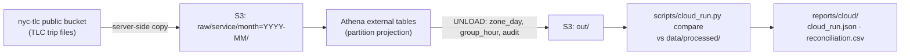

# Running the pipeline on AWS (S3 + Athena)

The analysis runs on daily aggregates that `scripts/build_data.py` builds on a
laptop with DuckDB, one monthly file at a time. This folder runs the same
aggregation in the cloud: the 168 raw files (30 GB, 1.3 billion trips) sit in
S3, and Amazon Athena reduces them with SQL in a few queries. The output is
then checked against the committed aggregates, row by row.



| File | What it is |
|---|---|
| `template.yaml` | CloudFormation: private encrypted bucket, Athena workgroup with a per-query scan cap, Glue database, monthly cost budget with email alerts, least-privilege runner policy |
| `../src/congestion/athena.py` | The Athena SQL, generated from the same constants as the DuckDB ETL (zones, peak hours, cleaning rules) |
| `sql/` | Every statement the pipeline runs, written out for reading (CI checks they match the generator) |
| `../scripts/cloud_run.py` | Copy, create tables, build, download, compare, tear down |
| `../tests/test_athena_sql.py` | Translates the Athena SQL to DuckDB with sqlglot and checks it gives the same aggregates as the laptop ETL |

## Design choices

- **Same answer as the laptop build, checked.** Two pipelines that drift apart
  are worse than one. The Athena SQL is generated from the constants in
  `etl.py` and `zones.py`, the tests run it (translated to DuckDB) against the
  laptop ETL on test files, and the cloud run compares every service × month
  with the committed aggregates. Before any AWS run, the translated SQL was
  also checked on three real months (yellow 2022-01, green 2023-02, Uber/Lyft
  2025-01): identical rows and counts.
- **Schema drift handled in the table definition.** Reading the footers of all
  168 files showed zone ids stored as INT64 until January 2023 and INT32 after,
  the fee column only from January 2025, and the shared-ride flags changing
  string type in February 2023. The tables declare `bigint` for zone ids
  (Athena widens INT32 to BIGINT but not the reverse) and read columns by
  name, so missing fees come back as NULL.
- **Partition projection, not a crawler.** Partitions are computed from the key
  layout (`month=YYYY-MM`), so there is no Glue crawler to run or pay for, and
  a query for one year only lists that year's files.
- **Guardrails on spend.** The workgroup cancels any query that would scan more
  than 50 GiB (the largest query scans about 19 GB), query results expire after
  7 days, and a budget emails at 80% of $10 actual or 100% forecast.
- **Three passes over the data instead of one.** zone_day, group_hour and the
  audit each re-read the raw files (about 21 GB per pass, columns pruned).
  Writing a cleaned intermediate table would save about $0.20 per run;
  three independent queries are simpler to test and re-run.

## Cost

| Item | Estimate |
|---|---|
| Athena scans: 9 queries, about 60 GB in total at $5 per TB | about $0.30 |
| S3 storage: 30 GB of raw files | about $0.70 per month, $0 after teardown |
| Copy into S3 (from AWS's public copy, or the TLC download site if that is not readable) | free: data into AWS is not charged; a few cents in requests |
| Table definitions (DDL), CloudFormation | free |

Measured figures from the run are in `reports/cloud/cloud_run.json`.

## Run it

You need an AWS account. Everything below runs in **AWS CloudShell**, a
terminal in the AWS console, so no access keys are ever created or stored on
a laptop.

### 1. Account set-up (once, about 15 minutes)

1. Create an account at [aws.amazon.com](https://aws.amazon.com/) (a card is required).
2. Turn on **MFA for the root user**: account menu → *Security credentials* → *Assign MFA device*.
3. Create a day-to-day user so the root user is not used again: open **IAM** →
   *Users* → *Create user*, tick *Provide user access to the AWS Management
   Console*, attach the policy `AdministratorAccess`, then sign out and sign
   in as that user and give it MFA too.
4. Pick the region (top right). Use **US East (N. Virginia) us-east-1** if
   your account allows it: AWS's copy of the TLC files lives there. New
   accounts created through AWS's newer sign-up flow can only use regional
   services such as Athena in the one region chosen for the account (other
   regions return `explicit deny in a service control policy`). Find it in
   CloudShell with:

   ```bash
   for r in us-east-1 us-east-2 us-west-1 us-west-2; do
     aws athena list-work-groups --region $r --output text >/dev/null 2>&1 && echo "use $r"
   done
   ```

   Switch the console to the region it prints. CloudShell and every command
   below then use it automatically.

### 2. Deploy the stack (about 2 minutes)

Open **CloudShell** (the `>_` icon in the console's top bar), then:

```bash
git clone https://github.com/janeruxi1/nyc-congestion-toll-causal-impact.git
cd nyc-congestion-toll-causal-impact
pip3 install -r cloud/requirements.txt

aws cloudformation deploy \
  --template-file cloud/template.yaml \
  --stack-name tlc-athena \
  --parameter-overrides BudgetEmail=you@example.com \
  --capabilities CAPABILITY_IAM
```

### 3. Run the pipeline (about 15-25 minutes)

CloudShell closes after 20-30 minutes without a key press, even while a
command runs, so run the steps one at a time and press a key now and then.
Each step can be re-run; `copy` skips files already copied.

```bash
python3 scripts/cloud_run.py copy      # 168 files -> your bucket
python3 scripts/cloud_run.py tables    # 3 external tables
python3 scripts/cloud_run.py build     # 9 queries, results to data/cloud/
python3 scripts/cloud_run.py compare   # -> reports/cloud/
```

Bring the two result files back into the repository: in CloudShell choose
*Actions* → *Download file* for
`nyc-congestion-toll-causal-impact/reports/cloud/cloud_run.json` and
`.../reports/cloud/reconciliation.csv`, put them in `reports/cloud/`, and
commit them.

### 4. Query it yourself (optional)

The raw tables stay queryable until teardown. In the Athena console, choose
the `tlc-athena` workgroup and try, for example, the toll zone's share of
Uber/Lyft pickups by year (about 2 GB scanned, one cent):

```sql
SELECT year(pickup_datetime) AS year,
       count(*) AS trips,
       round(100.0 * count_if(PULocationID IN (4, 12, 13, 45, 48, 50, 68, 79, 87, 88, 90, 100,
             107, 113, 114, 125, 137, 144, 148, 158, 161, 162, 163, 164, 170, 186, 209, 211,
             224, 229, 230, 231, 232, 233, 234, 246, 249, 261)) / count(*), 2) AS toll_zone_pct
FROM tlc.raw_hvfhv
WHERE month BETWEEN '2023-01' AND '2025-12'
GROUP BY 1
ORDER BY 1;
```

### 5. Tear down (about 2 minutes)

```bash
python3 scripts/cloud_run.py teardown   # empties the bucket, deletes the stack
```

This removes everything the stack created, including the budget. Check
*Billing* → *Bills* a day later to confirm the charges.

### Running without admin rights

The stack outputs `RunnerPolicyArn`, a policy with only what
`cloud_run.py` needs (its bucket, its workgroup, its Glue tables, read access
to the public TLC bucket). Attach it to a role for CI or a laptop instead of
using an administrator.
